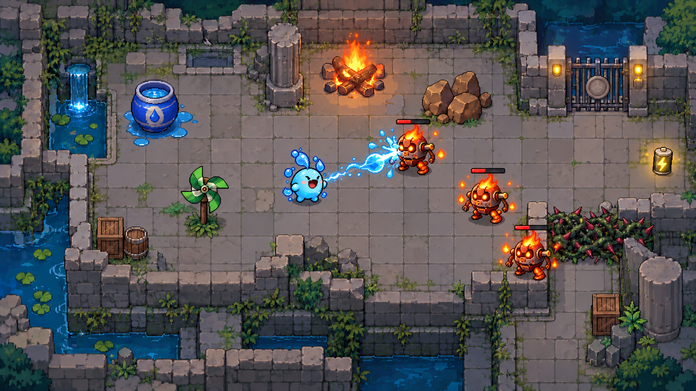
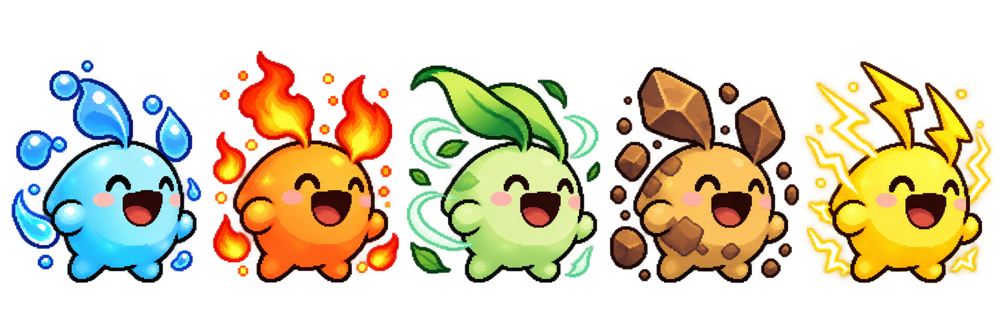

# 엘리먼트 이터 (Element Eater)

주변 사물을 먹으면 주인공의 색과 외형이 바뀌고, 적의 약점에 맞는 원소로만 공격할 수 있는 2D 탑뷰 액션 게임 프로젝트입니다.

현재는 **기획 단계**입니다. 상세 기획서와 발표 자료, AI 컨셉 이미지가 준비되어 있고, 실행 가능한 게임 코드는 아직 구현하지 않았습니다. 개발 도구는 Python과 pico2d를 계획하고 있습니다.



위 이미지는 실제 구현 화면이 아닌 AI 생성 컨셉입니다.

## 최신 자료

- [상세 기획서 30쪽](outputs/planning/엘리먼트_이터_기획서_허찬휘.pptx)
- [1차 발표 PPT 7쪽](outputs/presentations/first/엘리먼트_이터_1차발표_허찬휘.pptx)
- [90초 발표 대본 PDF](outputs/presentations/first/엘리먼트_이터_90초_발표대본_허찬휘.pdf)
- [방 10개와 원소 변환 보스](docs/design/STAGES_AND_BOSS.md)
- [게임 규칙과 초기 수치](docs/design/GAME_DESIGN.md)
- [개발 순서와 작업 목록](docs/development/ROADMAP.md)
- [노트북에서 작업 이어가기](docs/guides/LAPTOP_SETUP.md)
- [현재 작업 맥락](PROJECT_CONTEXT.md)
- [1차 발표 영상](outputs/presentations/first/2023184037_허찬휘_엘리먼트이터_1차발표영상.mp4)
- [무속성 주인공 스프라이트](assets/sprites/hero/neutral/README.md)
- [pixelfx 이펙트 도구 사용법](docs/guides/PIXELFX_USAGE.md)

## 원소 능력

| 원소 | 확정된 역할 |
| --- | --- |
| 불 | 화상으로 적에게 지속 피해 |
| 물 | 플레이어 자가 치유 |
| 바람 | 적 밀쳐내기 |
| 흙 | 지형 생성 |
| 번개 | 여러 적에게 이어지는 연쇄 공격 |

한 번에 원소 하나를 보유하고, 새 사물을 먹으면 몸 색과 귀, 표면 특징을 함께 바꿉니다. 색뿐 아니라 형태로도 현재 원소를 구분합니다.



적도 원소를 가지며 **물은 불, 불은 바람, 바람은 흙, 흙은 번개, 번개는 물**인 적만 공격할 수 있습니다. 같은 원소를 포함한 다른 조합은 피해와 공격 효과가 모두 차단됩니다.

왼쪽 클릭은 현재 원소의 기본 공격이고, 오른쪽 클릭은 위 표의 고유 능력입니다. 물도 기본 공격으로 불 적을 때릴 수 있으며, 고유 능력은 자가 치유를 유지합니다. 기본 공격은 횟수를 소모하지 않고, 고유 능력만 먹이당 3회 사용합니다. 횟수가 0이어도 원소와 외형은 유지하며 먹이는 재생성합니다.

전투와 퍼즐을 해결하며 일반 방 9개와 원소 변환 보스 방 1개, 총 10개의 방을 돌파하는 구상입니다. 일반 방은 적 처치와 필수 환경 퍼즐 해결을 함께 확인해 출구를 엽니다. 3회, 피해 배율 1.5, 먹이 재생성 8초 등은 [초기 기획안](docs/design/GAME_DESIGN.md)이며 테스트 후 조정합니다. 흙의 충격파와 번개의 기절은 기획에 포함하지 않습니다.

상세 기획 PPT는 30쪽, 1차 발표 PPT는 7쪽입니다. 원소 환경 퍼즐과 원소 변환 보스를 포함한 최신 규칙은 기획 문서에 정리했습니다. 무속성 주인공의 4방향 걷기 시트와 프레임 메타데이터도 준비했으며 게임 연동은 아직 하지 않았습니다.

## 노트북에서 시작

Git을 설치한 뒤 터미널에서 실행합니다.

```powershell
git clone https://github.com/chanwhee0330/element-eater.git
cd element-eater
```

이 폴더를 Codex나 코드 편집기에서 열고, `PROJECT_CONTEXT.md`를 기준으로 작업을 이어가면 됩니다. 기획 자료는 `outputs`의 PPTX와 PDF를 직접 열어 편집할 수 있습니다. 게임 실행과 Python 환경 설치는 첫 프로토타입 구현 단계에서 안내를 추가할 예정입니다.

## 폴더 구성

```text
assets/
  concepts/          현재 컨셉 이미지
    archive/         이전 버전 이미지
  sprites/           게임용 스프라이트와 프레임 데이터
  prompts/           이미지 생성 프롬프트와 제작 기록
docs/
  design/            게임 기획, 방과 보스 설계
  development/       개발 계획과 작업 목록
  guides/            PC 간 작업과 설치 안내
outputs/
  planning/          상세 기획 PPT
  presentations/
    first/           1차 발표 PPT, 대본, 영상
src/                 게임 코드 개발 위치
PROJECT_CONTEXT.md   작업 현황과 다음 작업
```

최종 발표 목표는 2026년 12월 둘째 주입니다. 정확한 발표 날짜는 미확정입니다.
