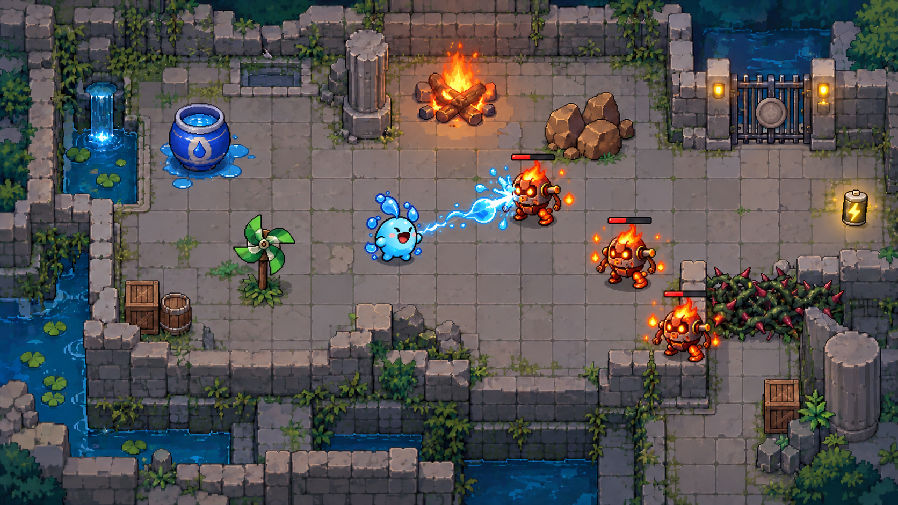
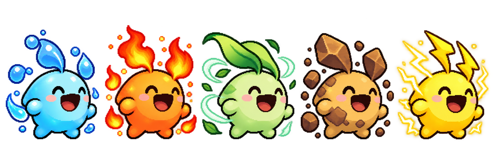

# 엘리먼트 이터 (Element Eater)

원소를 먹어 외형과 공격을 바꾸고 유적을 돌파하는 Python/pico2d 2D 탑뷰 액션 게임입니다. 1번 방은 무속성으로 진행합니다. 2~6번 방에서는 수호 적과 장치를 돌파해 물·불·바람·흙·번개를 차례로 배웁니다. 7~9번 방에서는 배운 원소로 복합 퍼즐을 해결하고, 10번 방에서 원소 변환 보스를 상대합니다. [첫 원소 습득 방](docs/design/ELEMENT_ACQUISITION_ROOMS.md)

## 게임 실행

실행하면 타이틀 화면이 먼저 나옵니다. 버튼은 **이어하기 / 새게임 시작 / 종료** 순서입니다. 마우스로 클릭하거나 좌우 방향키로 선택 후 Enter를 누릅니다. 저장된 진행이 없으면 이어하기가 비활성화되며, 있으면 아래에 스테이지 번호가 표시됩니다. [타이틀 화면](outputs/previews/title-screen/title-no-save.png) · [저장된 진행이 있는 화면](outputs/previews/title-screen/title-with-save.png)

Windows 64비트 Python 3.11을 기준으로 저장소 폴더에서 실행합니다. Python 3.11.1에서 검증했습니다.

```powershell
python -m venv .venv
.\.venv\Scripts\python.exe -m pip install -r requirements.txt
.\.venv\Scripts\python.exe main.py
```

설치 후에는 `run_game.bat`을 더블클릭해도 됩니다. **WASD 이동**, **Space 기본 공격**, **F 구슬 섭취**, **Q/E 원소 선택**, **R 원소 스킬**, **G 장치 작동**, **Esc 메뉴**입니다. 조준은 마지막 이동 방향입니다. 타이틀의 숫자 `1`~`9`와 `0`으로 저장을 유지한 채 해당 방을 연습할 수 있습니다. [자세한 설치·검사 안내](docs/guides/LAPTOP_SETUP.md)

진행은 `saves/continue.json`에 자동 저장합니다. 구슬을 먹으면 해금과 장치 상태를 저장하고, 다음 방으로 넘어갈 때 체력과 배운 원소를 이어갑니다. 이전 배치에서 만든 1~6번 방 저장은 체력을 유지한 채 새 배치의 방 입구에서 이어집니다. 저장 파일은 기기별 로컬 데이터이며 Git에 포함하지 않습니다.



위 이미지는 과거 AI 생성 컨셉입니다. 조작키와 원소 보관·소모 규칙은 아래 최신 기획을 기준으로 확인합니다.

## 최신 자료

- [Python/pico2d 개발 PRD](docs/design/PRD.MD): 확정 요구사항, 미확정 항목, 준비된 에셋, 테스트 방부터의 구현 순서와 완료 기준

- [맵에 놓인 원소 5종 애니메이션](outputs/previews/element-pickups/element-pickups-map.gif) · [확대 동작](outputs/previews/element-pickups/element-pickups-animation.gif) · [재생·정지·속도 조절](outputs/previews/element-pickups/element-pickups-preview.html) · [스프라이트 시트와 규격](assets/items/elements/README.md)

- [맵 일부를 보여주는 인게임 화면 시안](outputs/previews/obstacle-room/obstacle-room-ingame-preview.png): 1280×720, 16×9칸 구도와 기존 플레이어·HUD 배치 예시

- [구멍·벽·가시를 배치한 30×30 맵](outputs/previews/obstacle-room/obstacle-room-preview.html) · [예시 화면](outputs/previews/obstacle-room/obstacle-room-scale-preview.png) · [원본·규격](assets/maps/obstacle-room/README.md)

- [기본 맵 30×30과 플레이어 크기 비교](outputs/previews/base-room/base-room-preview.html) · [비교 PNG](outputs/previews/base-room/base-room-scale-preview.png) · [맵 원본·규격](assets/maps/base-room/README.md)

- [상세 기획서 30쪽](outputs/planning/엘리먼트_이터_기획서_허찬휘.pptx)
- [1차 발표 PPT 7쪽](outputs/presentations/first/엘리먼트_이터_1차발표_허찬휘.pptx)
- [90초 발표 대본 PDF](outputs/presentations/first/엘리먼트_이터_90초_발표대본_허찬휘.pdf)
- [방 10개와 원소 변환 보스](docs/design/STAGES_AND_BOSS.md)
- [게임 규칙과 초기 수치](docs/design/GAME_DESIGN.md)
- [구멍·벽·가시 장애물 기획](docs/design/OBSTACLES_AND_HAZARDS.md)
- [개발 순서와 작업 목록](docs/development/ROADMAP.md)
- [노트북에서 작업 이어가기](docs/guides/LAPTOP_SETUP.md)
- [현재 작업 맥락](PROJECT_CONTEXT.md)
- [1차 발표 영상](outputs/presentations/first/2023184037_허찬휘_엘리먼트이터_1차발표영상.mp4)
- [무속성 주인공 스프라이트](assets/sprites/hero/neutral/README.md)
- [무속성 충격탄·발사·명중 효과](assets/effects/neutral/README.md)
- [pixelfx 이펙트 도구 사용법](docs/guides/PIXELFX_USAGE.md)

## 원소 능력

| 원소 | 확정된 역할 |
| --- | --- |
| 불 | 화상으로 적에게 지속 피해 |
| 물 | 플레이어 자가 치유 |
| 바람 | 적 밀쳐내기 |
| 흙 | 지형 생성 |
| 번개 | 여러 적에게 이어지는 연쇄 공격 |

먹은 원소를 종류별 개수로 보관하고 Q/E로 하나를 선택합니다. 몸 색과 귀, 표면 특징은 선택한 원소를 따라 바뀌며 색뿐 아니라 형태로도 구분합니다.



원소 기본 공격에는 **물→불→바람→흙→번개→물** 상성을 적용합니다. 번개 `R`은 속성에 관계없이 적에게 연쇄 피해를 줍니다. 무속성 충격탄은 원소 적에게 낮은 피해와 약한 넉백을 줍니다. **무속성 적은 무속성·다섯 원소 공격 모두에 큰 피해**를 받습니다. 낮은 피해 5·큰 피해 15는 시험값입니다. 약한 넉백은 무속성 기본 공격에만 붙습니다.

## 조작과 원소 소모

| 키 | 행동 |
| --- | --- |
| WASD | 이동 |
| Q / E | 보유한 이전 / 다음 원소 선택 |
| R | 선택 원소의 고유 스킬, 성공 시 해당 원소 1개 소모 |
| F | 원소 먹기, 같은 종류의 보유 개수 누적 |
| Space | 기본 공격, 원소 소모 없음 |
| Esc | 일시정지·재개, 메뉴에서 현재 방 재시작 |

공격은 마지막 이동 방향을 사용하며 마우스로 조준하지 않습니다. 예를 들어 불을 2개 먹고 R 스킬을 한 번 사용하면 불 1개가 남습니다. 같은 종류가 0개가 되면 선택에서 빠지고, 전부 소진되면 무속성 충격탄을 사용합니다. 물 Space 공격은 불 적에게 피해를 주고 물 R 스킬은 자가 치유입니다. 번개를 선택하고 `R`로 충전하면 플레이어 주변에 전기가 흐릅니다. 충전 뒤 `Space`로 최대 3명에게 연쇄 피해를 주며, 적중한 순간에 번개 1개를 소모합니다. 공격이 끝나면 번개가 남아 있을 때는 번개 형태, 소진했을 때는 무속성 형태가 됩니다.

무속성 Space 공격은 무속성 적에게 큰 피해, 원소 적에게 낮은 피해와 짧은 넉백을 줍니다. 무속성 R 스킬은 없습니다. 피해 5/15, HP 100·근접 HP 30·원거리 HP 40·적 피해 10 등은 `src/combat.py`의 시험값입니다. 두 번째 방의 물 항아리는 무속성/물 3타로 파괴하고 F로 구슬만 먹습니다. 물 R은 최대 20 회복 성공 시 물 1개를 소모하며 최대 체력에서는 소모하지 않습니다. 현재 획득 가능한 원소는 물입니다.

전투와 퍼즐을 해결하며 일반 방 9개와 원소 변환 보스 방 1개, 총 10개의 방을 돌파하는 구상입니다. 일반 방은 적 처치와 필수 환경 퍼즐 해결을 함께 확인해 출구를 엽니다. 피해 배율 1.5, 먹이 재생성 8초 등은 [초기 기획안](docs/design/GAME_DESIGN.md)이며 테스트 후 조정합니다. 흙의 충격파와 번개의 기절은 기획에 포함하지 않습니다.

상세 기획 PPT는 30쪽, 1차 발표 PPT는 7쪽입니다. 원소 환경 퍼즐과 원소 변환 보스를 포함한 최신 규칙은 기획 문서에 정리했습니다. 무속성 주인공의 최신 중심 보정 대기·걷기 시트(각 방향 8프레임)는 첫 방 Python 프로토타입에 연결했습니다. [움직임 미리보기](outputs/previews/hero-neutral/hero-neutral-preview.html)에서도 확인할 수 있습니다.

## 노트북에서 시작

Git을 설치한 뒤 터미널에서 실행합니다.

```powershell
git clone https://github.com/chanwhee0330/element-eater.git
cd element-eater
```

이 폴더를 Codex나 코드 편집기에서 열고, `PROJECT_CONTEXT.md`를 기준으로 작업을 이어가면 됩니다. 게임은 위의 가상환경 설치·실행 명령을 사용합니다. 기획 자료는 `outputs`의 PPTX와 PDF를 직접 열어 편집할 수 있습니다.

## 폴더 구성

```text
assets/
  concepts/          현재 컨셉 이미지
    archive/         이전 버전 이미지
  sprites/           게임용 스프라이트와 프레임 데이터
  items/             원소 먹이 5종과 반복 대기 스프라이트
  prompts/           이미지 생성 프롬프트와 제작 기록
docs/
  design/            게임 기획, 방과 보스 설계
  development/       개발 계획과 작업 목록
  guides/            PC 간 작업과 설치 안내
outputs/
  planning/          상세 기획 PPT
  presentations/
    first/           1차 발표 PPT, 대본, 영상
src/                 1·2번 방 게임 상태·pico2d 렌더러
PROJECT_CONTEXT.md   작업 현황과 다음 작업
```

최종 발표 목표는 2026년 12월 둘째 주입니다. 정확한 발표 날짜는 미확정입니다.
