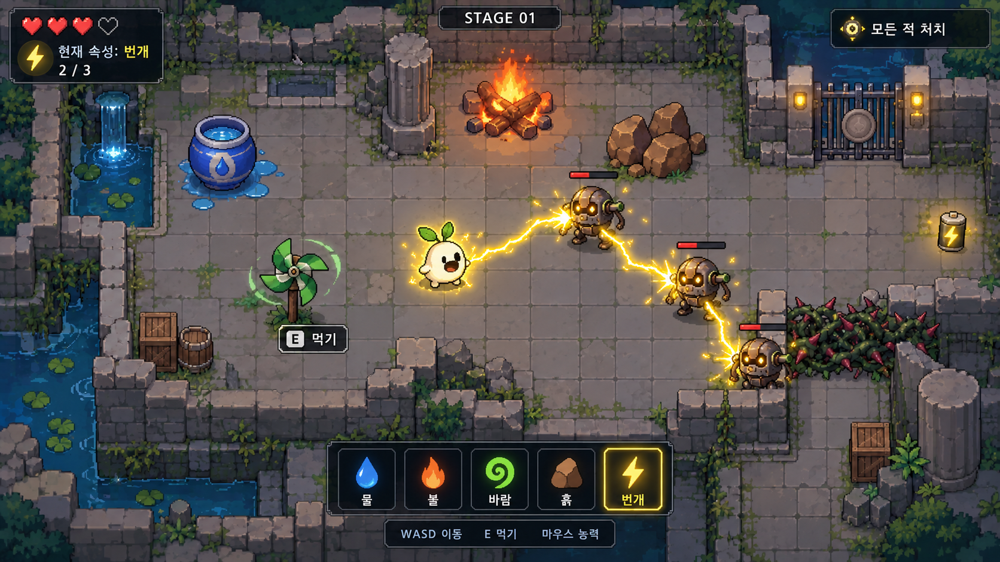

# 엘리먼트 이터 (Element Eater)

주변 사물을 먹어 원소를 얻고, 원소 능력으로 적과 지형을 공략하는 2D 탑뷰 액션 게임 프로젝트입니다.

현재는 **기획 단계**입니다. 상세 기획서와 발표 자료, AI 컨셉 이미지가 준비되어 있고, 실행 가능한 게임 코드는 아직 구현하지 않았습니다. 개발 도구는 Python과 pico2d를 계획하고 있습니다.



위 이미지는 실제 구현 화면이 아닌 AI 생성 컨셉입니다.

## 최신 자료

- [상세 기획서 20쪽](outputs/엘리먼트_이터_기획서_허찬휘.pptx)
- [1차 발표용 PPT 7쪽](outputs/엘리먼트_이터_1차발표_허찬휘.pptx)
- [90초 발표 대본 PDF](outputs/엘리먼트_이터_90초_발표대본_허찬휘.pdf)
- [게임 규칙과 초기 수치](docs/GAME_DESIGN.md)
- [개발 순서와 작업 목록](docs/ROADMAP.md)
- [노트북에서 작업 이어가기](docs/LAPTOP_SETUP.md)
- [현재 작업 맥락](PROJECT_CONTEXT.md)

## 원소 능력

| 원소 | 확정된 역할 |
| --- | --- |
| 불 | 화상으로 적에게 지속 피해 |
| 물 | 플레이어 자가 치유 |
| 바람 | 적 밀쳐내기 |
| 흙 | 지형 생성 |
| 번개 | 여러 적에게 이어지는 연쇄 공격 |

한 번에 원소 하나를 보유하고, 새 사물을 먹으면 교체합니다. 먹은 사물은 현재 방에서 사라집니다. 모든 적을 처치해 출구를 열고 4개의 방을 돌파하는 구상입니다.

사용 횟수, 피해량, 회복량, 적 배치 등은 [초기 기획안](docs/GAME_DESIGN.md)이며 테스트 후 조정합니다. 물의 공격 능력, 흙의 충격파, 번개의 기절은 현재 기획에 포함하지 않습니다.

## 노트북에서 시작

Git을 설치한 뒤 터미널에서 실행합니다.

```powershell
git clone https://github.com/chanwhee0330/element-eater.git
cd element-eater
```

이 폴더를 Codex나 코드 편집기에서 열고, `PROJECT_CONTEXT.md`를 기준으로 작업을 이어가면 됩니다. 기획 자료는 `outputs`의 PPTX와 PDF를 직접 열어 편집할 수 있습니다. 게임 실행과 Python 환경 설치는 첫 프로토타입 구현 단계에서 안내를 추가할 예정입니다.

## 폴더 구성

```text
assets/concepts/    캐릭터, 먹이, 플레이 화면 컨셉
docs/               규칙, 개발 계획, 기기 간 작업 안내
outputs/            최신 기획서와 발표 자료
src/                게임 코드 개발 예정 위치
PROJECT_CONTEXT.md  다음 작업에 필요한 결정 사항
```

최종 발표 목표는 2026년 12월 둘째 주입니다. 정확한 발표 날짜는 미확정입니다.
