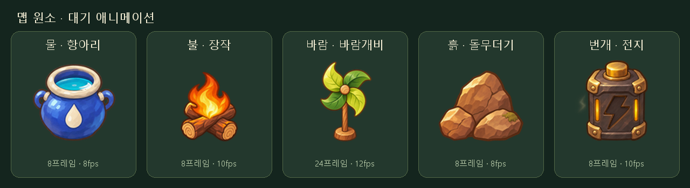

# 원소 먹이 · 맵 대기 애니메이션

기존 먹이 종류인 물 항아리, 불타는 장작, 바람개비, 돌무더기, 전지를 같은 손그림 스타일로 만들었습니다. 바람개비는 **24프레임**, 나머지는 **8프레임**의 반복 대기 동작입니다. 섭취나 공격 동작이 아니라 맵에 놓인 상태의 애니메이션입니다.

사용자 피드백에 따라 다섯 원소 모두 **고정 부분 + 동작 레이어** 방식으로 만들었습니다. 항아리와 손잡이는 고정하고 수면 안의 물결만 바꿉니다. 불은 장작을 먼저 그리고 그 윗면에 불꽃을 앞쪽으로 합성해 타오르게 합니다. 흙은 뒤의 큰 돌과 오른쪽 이끼 돌을 한 장으로 고정하고 왼쪽 아래 작은 돌 한 장만 살짝 들고 기울입니다. 전지의 케이스·단자·옆 줄은 고정하며, 중앙 번개 표시의 위치와 형상은 유지한 채 소등·점등을 보간하고 양옆 스파크도 재생합니다. 바람개비는 받침대와 나무 축·중앙 허브를 유지하고 단일 날개 원화를 같은 중심으로 회전합니다.



| 원소 | 동작 | fps | 한 바퀴 | 표시 높이 예시 |
| --- | --- | --- | --- | --- |
| 물 항아리 | 수면 잔물결과 반사광 | 8 | 1초 | 0.85칸 |
| 불 장작 | 장작 윗면 앞에서 불꽃이 타오름 | 10 | 0.8초 | 0.95칸 |
| 바람개비 | 고정 축 주위 날개만 회전, 24프레임 | 12 | 2초 | 1.15칸 |
| 흙 돌무더기 | 다른 두 돌은 고정, 왼쪽 아래 돌만 들썩임 | 8 | 1초 | 0.75칸 |
| 번개 전지 | 중앙 번개 표시 점멸 + 양옆 스파크 | 10 | 0.8초 | 0.85칸 |

표시 크기와 속도는 시안 값입니다. 1칸은 기존 무속성 플레이어의 잎부터 발끝까지 높이입니다.

## 파일과 프레임 규격

- `water-idle`, `fire-idle`, `wind-idle`, `earth-idle`, `lightning-idle`: 각각 **PNG + JSON** 한 쌍입니다. 바람 시트는 3072×128px(24칸), 나머지는 1024×128px(8칸)입니다.
- [통합 PNG](element-pickups.png)와 [통합 JSON](element-pickups.json): **3072×640px**, 24열×5행. 위부터 물·불·바람·흙·번개이며 바람을 제외한 행은 앞 8칸만 사용합니다. JSON의 원소별 `frameCount`를 따릅니다.
- 모든 칸은 **128×128px**, 왼쪽부터 차례대로 재생하고 마지막 다음에 0번으로 돌아갑니다. 별도 종료 프레임은 없습니다.
- 좌상단 원점의 공통 발밑 기준점은 **(64, 114)**입니다. 개별 시트와 통합 시트에서 같습니다.
- JSON의 `duration`은 밀리초입니다. 개별 JSON의 `meta.animation`에 fps, 프레임 수, 반복 여부가 있습니다. 통합 JSON의 `elements`에 fps, 행 번호, 표시 높이, 기준 원화 높이와 개별 파일명이 있습니다.
- `source/*-source.png`는 최초 디자인, `source/*-idle-source.png`는 이전 전체 물체 원화, `source/recipe.json`은 패킹 설정입니다. 이전 원화도 보관합니다.
- `source/layers/`에 새로 분리한 고정 본체·동작 원화, `layer-recipe.json`, 베이크된 시트와 고정 영역 마스크가 있습니다. 물결은 수면 타원 안으로 제한하고, 바람의 회전 중심은 칸 내부 **(64, 48)**로 고정합니다. 날개는 한 프레임에 15도씩 시계 방향으로 돌며 중앙 나무 허브는 같은 이미지를 복사합니다. 발밑 피벗 (64, 114)과 회전 중심은 별개입니다.
- 불꽃 밑동은 칸 내부 **(64, 84)** 부근의 장작 윗면에 놓고 `장작 → 불꽃` 순서로 그립니다. 장작 자체는 같은 원화이며 불꽃이 겹치지 않는 부분을 고정합니다.
- 흙의 변화는 `earth-moving-mask.png`의 왼쪽 아래 영역으로 제한합니다. 번개는 `lightning-bolt-mask.png` 안에서만 중앙 표시를 점멸시키므로 케이스와 옆 줄의 픽셀은 변하지 않습니다. 점멸 계수는 `0 → 0.12 → 0.55 → 1 → 0.85 → 0.45 → 0.12 → 0`입니다.

시간 `t`초의 프레임은 `floor(t * fps) % frameCount`입니다. 화면의 발밑 위치 `(x, y)`에 그릴 때 배율 `s`를 정하고 이미지 왼쪽 위를 `(x - 64*s, y - 114*s)`에 놓습니다. 칸 단위 높이를 맞출 때는 `s = 화면의 1칸 픽셀 수 * heightUnits / referenceSolidHeightPixels`를 사용합니다. 원소의 프레임 전체에 같은 배율을 사용합니다.

pico2d의 `clip_draw`는 아래쪽 원점이므로 JSON의 프레임 `y`를 `시트높이 - y - h`로 바꿉니다. 화면 발밑 `(gx, gy)`를 기준으로 하면 그리기 중심은 `(gx, gy + (114 - 64)*s)`, 크기는 `(128*s, 128*s)`입니다. 그림자는 시트에 굽지 않고 미리보기에서 별도로 그립니다.

## 미리보기와 다시 만들기

- [맵 배치 애니메이션 GIF](../../../outputs/previews/element-pickups/element-pickups-map.gif)
- [원소별 확대 애니메이션 GIF](../../../outputs/previews/element-pickups/element-pickups-animation.gif)
- [정지·한 프레임·속도 조절 HTML](../../../outputs/previews/element-pickups/element-pickups-preview.html): 이미지와 코드가 들어 있어 서버·인터넷 없이 열 수 있습니다.

```sh
python tools/build_element_pickups.py
python tools/render_element_pickups.py
```

Python과 Pillow가 필요합니다. 파일에 PC 전용 절대경로를 저장하지 않습니다. Windows에서는 맑은 고딕, 다른 환경에서는 Pillow 기본 글꼴을 사용합니다.

배치 시안은 기존 30×30 장애물 맵의 16×9칸 구도를 재사용합니다. `assets/maps/obstacle-room/source/element-pickup-view.json`의 `ground`는 발밑 좌표이며 안전한 바닥 ID 0~2에만 놓고 플레이어와 발밑 y 순서로 그립니다. 다섯 종류를 한 화면에 모은 디자인 비교 예시이며 1번 방의 실제 먹이 종류를 바꾸는 설정은 아닙니다. 기존 빈 기본 맵과 먹이 없는 장애물 미리보기는 유지합니다. 실제 F 섭취·보유 개수·재생성과 본게임 판정은 구현 전입니다.

분리 원화는 내장 image_gen을 사용했습니다. `tools/bake_pickup_layers.py`가 같은 본체와 효과를 합성하고 고정 영역의 RGBA가 전 프레임에서 같은지 검사합니다. 바람의 회전과 작은 돌의 이동은 고정 원화의 수치 변환입니다. [불·흙·번개 재조정 프롬프트](../../prompts/element-pickup-polish.md), [고정 본체 보정 프롬프트](../../prompts/element-pickup-fixed-layers.md), [초기 애니메이션 제작 기록](../../prompts/element-pickup-animations.md)을 함께 보관합니다.
