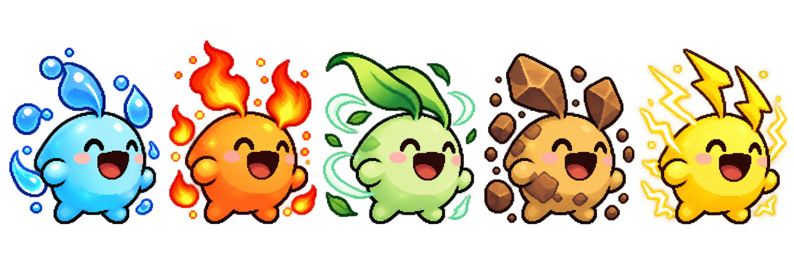
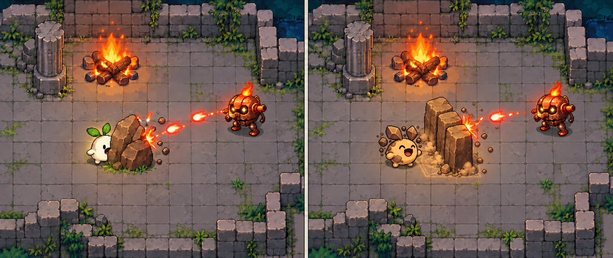

# 엘리먼트 이터 게임 기획

## 확정된 방향

주변 사물을 먹어 원소를 얻고 스테이지를 공략하는 2D 액션입니다. 제목과 아래 다섯 원소의 역할은 사용자가 정했습니다.

| 원소 | 역할 |
| --- | --- |
| 불 | 적에게 화상으로 지속 피해 |
| 물 | 플레이어 자가 치유 |
| 바람 | 적을 밀어내기 |
| 흙 | 새로운 지형 생성 |
| 번개 | 여러 적에게 이어지는 연쇄 공격 |

원소를 먹으면 주인공의 **몸 색과 외형 특징이 함께 바뀌어** 현재 원소를 한눈에 구분합니다. 적도 원소를 가지며, 사용자가 확정한 상성은 다음과 같습니다.

| 공격 원소 | 공격 가능한 적 원소 | 나머지 원소 적 |
| --- | --- | --- |
| 물 | 불 | 차단 |
| 불 | 바람 | 차단 |
| 바람 | 흙 | 차단 |
| 흙 | 번개 | 차단 |
| 번개 | 물 | 차단 |

같은 원소를 포함해 약점이 맞지 않으면 **피해 0, 적 대상 공격 효과 없음**으로 처리합니다. 단순히 피해량만 낮추는 방식이 아닙니다.

이하 규칙과 수치는 상세 기획서에서 구체화한 **초기 제안**입니다. 실제 구현과 플레이 테스트 후 조정합니다.

## 목표와 진행

- 한 화면 크기의 고정된 방 4개를 순서대로 돌파합니다.
- 방 안의 모든 적을 처치하면 출구가 열립니다.
- 네 번째 방에서 열린 출구에 도달하면 클리어합니다.
- 정상적인 방 이동 때 체력과 남은 원소 횟수를 유지합니다.
- 체력 0 또는 R 입력은 현재 방의 체력, 적, 먹이, 투사체와 임시 지형을 초기화합니다. 체력은 최대치, 원소는 무속성으로 재설정합니다.

## 조작

| 입력 | 행동 |
| --- | --- |
| WASD | 이동, 대각선 이동 속도 보정 |
| 마우스 이동 | 조준 |
| 왼쪽 클릭 | 현재 원소의 기본 원소탄, 횟수 소모 없음 |
| 오른쪽 클릭 | 현재 원소의 고유 능력, 먹이당 3회 |
| E | 범위 안 가장 가까운 먹이 1개 섭취 |
| R | 현재 방 재시작 |
| Esc | 일시정지 및 재개 |

물·바람·흙도 상성 공격을 할 수 있도록 기본 공격에 현재 원소를 부여합니다. 물의 기본 공격은 불 적을 공격하고, 물의 오른쪽 클릭은 기존 자가 치유를 유지합니다. 무속성에서는 공격할 수 없고 먼저 먹어야 합니다.

기본 피해 10, 약점 배율 1.5, 재사용 간격 0.4초, 사거리 320px를 제안합니다. 맞는 약점에 피해 15, 나머지에는 피해 0입니다. 기본 원소탄은 첫 적 또는 벽과 충돌하면 사라집니다. 기본 공격은 고유 능력 횟수를 소모하지 않습니다.

상성 판정은 첫 구현에서 플레이어가 적을 공격할 때 적용합니다. 플레이어가 적의 공격에 원소에 따라 면역이 되는 규칙은 두지 않습니다.

## 섭취와 자원

- 먹이는 물 항아리, 불붙은 장작, 바람개비, 돌무더기, 전지의 5종입니다.
- 장식물과 고정 벽, 적은 섭취 대상에서 제외합니다.
- 먹은 사물은 맵에서 사라집니다. 특히 돌을 먹으면 기존 엄폐물을 잃습니다. 초기 제안 8초 뒤 원래 위치가 비었을 때 재생성합니다. 캐릭터나 임시 지형과 겹치면 재등장을 잠시 미룹니다.
- 원소는 한 번에 하나 보유하며, 새 먹이는 이전 원소와 남은 횟수를 교체합니다.
- 같은 원소를 먹어도 횟수는 3으로 재설정하며 합산하지 않습니다.
- 고유 능력 횟수가 0이어도 원소와 외형, 기본 공격은 유지합니다. 다시 먹으면 고유 능력을 3회로 충전합니다. 이전의 0회 무속성 복귀 규칙은 폐기했습니다.
- 섭취 범위 64px, 원소 공통 재사용 간격 0.5초부터 테스트합니다.
- 이미 적용한 화상과 흙벽은 원소 교체 후에도 원래 지속시간까지 남습니다.
- 모든 방에 적의 약점을 공략할 필수 먹이를 제공하고 재생성합니다. 상성이 틀린 기본 공격으로 진행을 우회하지 않습니다.

## 원소별 주인공 외형

| 상태 | 몸 색 | 외형 특징 |
| --- | --- | --- |
| 무속성 | 아이보리 | 초록 잎 귀 |
| 물 | 파랑 | 물방울 모양 귀와 물빛 표면 |
| 불 | 주황빛 붉은색 | 불꽃 모양 귀와 작은 불꽃 |
| 바람 | 연두 | 뒤로 휘날리는 잎 모양 귀와 바람 |
| 흙 | 황갈색 | 바위 귀와 돌 표면 |
| 번개 | 노랑 | 번개 모양 귀와 전기 불꽃 |

색과 형태를 함께 구분하되 몸통 비율, 큰 입, 작은 팔다리와 기본 동작을 공유합니다. 섭취 순간 원소 데이터와 몸 색, 외형, HUD를 함께 갱신합니다. 고유 능력 횟수가 0이어도 변신은 유지합니다. 이미지와 구체적인 색·장식은 외형 컨셉이며 실제 게임용 애니메이션 시트가 아닙니다.

## 원소별 상세 동작

### 불

조준 방향으로 화염탄 1발을 발사합니다. 첫 적 또는 벽과 충돌하면 투사체가 사라집니다. **바람 적에게만** 3초 화상을 부여합니다. 기본 초당 피해 4에 상성 배율 1.5를 적용해 초당 6, 총 18부터 시험합니다. 직접 타격 피해는 없습니다. 재적중하면 지속시간만 갱신하고 화상을 중첩하지 않습니다. 다른 원소 적은 피해와 화상 모두 차단합니다. 발사 범위는 320px로 시작하고, 빗나가거나 상성이 틀린 적에 맞아도 발사했다면 고유 능력 횟수는 소모합니다.

### 물

자신의 체력을 즉시 20 회복합니다. 최대 체력은 100부터 시험합니다. 체력 95에서 사용하면 100이 되고 1회를 소모합니다. 이미 체력이 최대라면 발동하지 않고 횟수를 유지합니다.

이 고유 능력은 자기 회복이므로 적 상성과 무관합니다. 별도의 물 기본 공격으로 불 적에게 피해를 줄 수 있습니다.

### 바람

전방 90도, 반경 160px 범위의 **흙 적만** 최대 96px 밀어냅니다. 다른 원소 적은 넉백도 차단합니다. 벽을 통과시키지 않으며 직접 피해는 바람 기본 공격이 담당합니다. 적이 없더라도 고유 능력 사용 동작과 횟수 소모는 발생합니다.

### 흙

조준 방향의 가까운 빈 위치에 임시 흙벽을 만듭니다. 첫 구현은 앞쪽 96px 지점, 크기 96×32px, 가로 또는 세로 방향의 벽 1개를 제안합니다. 캐릭터, 먹이, 고정 지형 또는 출구와 겹치면 생성하지 않고 횟수를 유지합니다.

벽은 이동과 탄환을 막고 직접 피해를 주지 않습니다. 유지시간은 4초입니다. 한 번에 벽 하나만 유지하며, 새로운 벽을 성공적으로 생성하면 이전 벽을 제거합니다. 생성 실패 시 기존 벽을 그대로 둡니다. 컨셉 이미지의 세 블록은 하나의 연속된 벽입니다.

흙벽은 지형의 물리 충돌이므로 적 원소와 관계없이 이동과 탄환을 막습니다. 흙 기본 공격은 번개 적의 약점을 공략합니다.

### 번개

조준 방향 320px 안의 첫 **물 적**에서 시작해, 가까운 다른 물 적에게 차례로 이어집니다. 다음 대상 탐색 반경 200px, 최대 3명, 기본 피해 10에 상성 배율을 적용한 대상당 피해 15부터 시험합니다. 다른 원소 적은 타격과 연쇄 후보에서 제외합니다. 타격 목록으로 중복 공격을 막고, 벽에 막힌 대상도 제외합니다. 첫 대상이 없으면 발동하지 않고 횟수를 유지합니다. 한 명만 있으면 한 명만 공격하고 1회를 소모합니다. 기절은 주지 않습니다.

## 전투와 적

플레이어 최대 체력 100, 이동 속도 220px/초, 피격 후 무적 시간 0.7초를 초기값으로 제안합니다.

| 적 | 행동 | 초기 체력 | 공격 |
| --- | --- | --- | --- |
| 추격형 | 플레이어 추격, 고정 장애물 모서리 우회 | 30 | 접촉 피해 10 |
| 사격형 | 제자리에서 예고 후 직선 탄환 발사 | 40 | 탄환 피해 10 |

추격형 이동 속도는 110px/초부터 시험합니다. 동적 길찾기 구현을 줄이기 위해 고정 방에 우회 지점을 두고, 임시 흙벽에 막힌 적은 벽이 사라질 때까지 잠시 대기합니다. 탄환은 벽과 엄폐물에 맞으면 사라집니다.

각 적은 별도로 원소를 하나 가집니다. 행동 AI 2종을 공유하고, 원소에 따라 몸 색과 장식, 머리 위 원소 이름과 약점 아이콘을 바꿉니다. 독립 AI를 10종 만드는 계획이 아닙니다. 플레이어가 적에게 주는 피해와 화상, 넉백, 연쇄 타격은 모두 상성 판정을 먼저 통과해야 합니다.

## 방 구성 초기안

| 방 | 학습 | 먹이 | 적 |
| --- | --- | --- | --- |
| 1 | 불·바람 적으로 첫 상성과 외형 변화 학습 | 물 1, 불 2 | 추격형 2, 불·바람 각 1 |
| 2 | 흙·번개 적으로 거리 확보와 엄폐 | 바람 2, 흙 2 | 추격형 2, 사격형 1, 흙·번개 배정 |
| 3 | 물 적 무리에 연쇄 번개 | 번개 2, 물 1 | 추격형 3, 사격형 1, 모두 물 |
| 4 | 다섯 원소의 적을 약점별 공략 | 다섯 원소 각 1 | 추격형 3, 사격형 2, 다섯 원소 각 1 |

각 방에 필요한 약점 먹이를 모두 제공하고 재생성합니다. 고유 능력을 모두 써도 현재 원소의 기본 공격은 유지합니다. 방 2에서 바람과 흙은 고유 능력으로 위치와 엄폐를 돕고, 해당 원소의 기본 공격으로 약점 적을 처치합니다. 맞지 않는 원소로 강행하는 공략은 허용하지 않습니다.

## 화면과 리소스

상단에 체력과 현재 방, 남은 적 수를 표시합니다. 하단에 현재 원소 이름과 아이콘, 고유 능력의 남은 횟수를 표시합니다. 주인공 몸 색과 외형 특징으로 원소를 구분하고, 적 머리 위에는 적 원소와 필요한 약점 아이콘을 표시합니다. 상성 불일치는 피해 연출 대신 차단 표식과 효과음으로 알립니다. 가까운 먹이에 E 안내를 보여주고 흙벽 생성 위치의 유효성을 미리 표시합니다. 색상만 쓰지 않고 형태, 글자와 아이콘을 함께 사용합니다.

무속성 주인공은 아이보리색 몸체와 초록 잎 모양 귀, 큰 입이 있는 AI 컨셉입니다. 기본 비율과 동작을 공유하며 원소별 몸 색, 귀와 표면을 바꾸고, 방은 한 테마의 배치 변형으로 제작량을 줄입니다. 보스, 원소 합성, 장비 강화, 절차 생성과 온라인 기능은 초기 범위에 포함하지 않습니다.

## 검증할 조건

- 상성 25개 조합에서 적중 5개와 차단 20개가 정확히 구분됩니다. 같은 원소도 차단입니다.
- 상성이 틀리면 피해와 화상, 넉백, 연쇄 타격이 모두 없습니다.
- 먹이를 다시 얻을 수 있고, 고유 능력 0회여도 원소와 외형, 기본 공격은 유지됩니다.
- 섭취 순간 실제 원소, 몸 색과 특징, HUD가 모두 일치합니다.
- 물은 최대 체력을 넘기지 않으며, 최대 체력에서는 횟수를 쓰지 않습니다.
- 바람은 적을 벽 안이나 벽 너머로 밀지 않습니다.
- 흙벽은 잘못된 위치에 생기지 않고 4초 뒤 사라집니다.
- 번개는 한 번 사용에 같은 적을 두 번 공격하지 않습니다.
- 방 이동과 재시작 때 이전 방의 투사체와 임시 지형이 남지 않습니다.
- 일시정지 중 전투 타이머와 이동을 멈춥니다.
