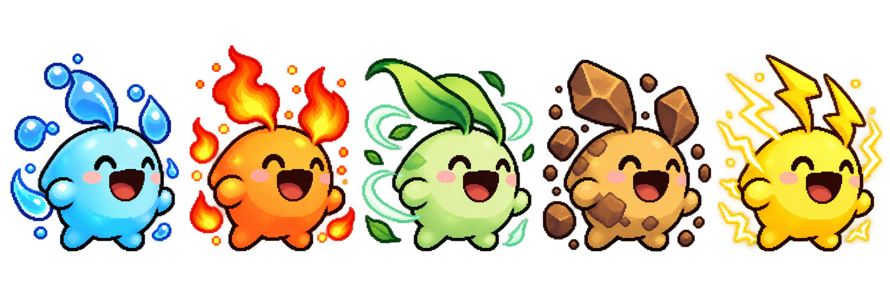
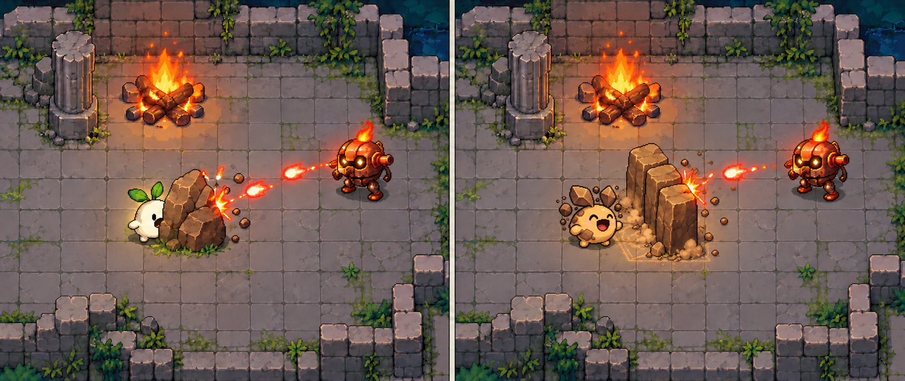

# 엘리먼트 이터 게임 기획

기준 자료: [상세 기획 PPT 30쪽](../../outputs/planning/엘리먼트_이터_기획서_허찬휘.pptx). 방·환경 퍼즐·보스 상세는 [STAGES_AND_BOSS.md](STAGES_AND_BOSS.md)에 정리했습니다.

## 확정된 방향

주변 사물을 먹어 원소를 얻고 스테이지를 공략하는 2D 액션입니다. 제목과 아래 다섯 원소의 역할은 사용자가 정했습니다.

| 원소 | 역할 |
| --- | --- |
| 불 | 적에게 화상으로 지속 피해 |
| 물 | 플레이어 자가 치유 |
| 바람 | 적을 밀어내기 |
| 흙 | 새로운 지형 생성 |
| 번개 | 여러 적에게 이어지는 연쇄 공격 |

원소를 먹으면 주인공의 **몸 색과 외형 특징이 함께 바뀌어** 현재 원소를 한눈에 구분합니다. 적도 원소를 가지며, 사용자가 확정한 상성은 다음과 같습니다.

| 공격 원소 | 공격 가능한 적 원소 | 나머지 원소 적 |
| --- | --- | --- |
| 물 | 불 | 차단 |
| 불 | 바람 | 차단 |
| 바람 | 흙 | 차단 |
| 흙 | 번개 | 차단 |
| 번개 | 물 | 차단 |

원소 공격은 같은 원소를 포함해 약점이 맞지 않으면 **피해 0, 적 대상 공격 효과 없음**으로 처리합니다. 사용자가 추가로 확정한 **무속성 기본 공격은 낮은 피해와 약한 넉백**이며, 적 원소와 관계없이 적용하는 별도 예외입니다.

원소별 역할, 상성, 무속성 공격, 조작키와 원소 보관·스킬 소모 방식은 **사용자 확정**입니다. 나머지 수치와 선택 순서·자동 선택 등의 운영 세부는 **초기 제안**이며 구현과 플레이 테스트 후 조정합니다.

## 목표와 진행

- 한 화면 크기의 고정된 방 10개를 순서대로 돌파합니다. 일반 방 9개와 원소 변환 보스 방 1개입니다.
- 일반 방에서는 모든 적 처치와 필수 환경 퍼즐 해결을 확인해 출구를 엽니다. 첫 방은 별도 필수 퍼즐 없이 섭취와 상성을 익힙니다.
- 10번째 방의 보스를 처치한 뒤 열린 최종 출구에 도달하면 클리어합니다.
- 정상적인 방 이동 때 체력, 원소별 보유 개수와 현재 선택을 유지합니다.
- 체력 0 또는 Esc 메뉴의 현재 방 재시작은 현재 방의 체력, 적, 먹이, 투사체와 임시 지형을 초기화합니다. 체력은 최대치, 원소 보관함은 비우고 무속성으로 재설정합니다.

## 현재 기본 맵의 크기 비교

사용자 요청으로 첫 비교용 기본 맵은 **플레이어 크기 1 : 맵 30×30**으로 만듭니다. 현재 표현 기준은 무속성 정면 대기 0번의 잎부터 발끝까지 높이 1칸이며, 원본 PNG 칸의 투명 여백을 포함하지 않습니다. 제작 해상도는 1칸 64px, 전체 1920×1920px입니다. 외곽 1칸 벽을 전체 크기에 포함하는 배치이며, 내부 바닥은 28×28칸입니다. 중앙에 플레이어를 띄워 먼저 크기감을 비교합니다. 외곽 벽 두께와 이동 속도는 시험 배치이며, 모든 방의 최종 크기를 30×30으로 확정한 것은 아닙니다. [맵 원본과 비교 자료](../../assets/maps/base-room/README.md)를 참고합니다.

## 장애물과 위험 지형

사용자가 장애물로 **구멍·낭떠러지, 벽, 가시**를 제안했습니다. 특히 바닥이 빈 구멍에는 **플레이어와 적 모두 추락할 수 있습니다**. 벽은 이동·사격선을 나누고, 가시는 밟지 않게 움직임을 유도하는 역할로 기획합니다. 세부 피해량·플레이어 복귀·적 추락 결과·가시 피해 대상은 초기안입니다. 넉백과 지형을 연결하는 규칙은 [장애물 상세](OBSTACLES_AND_HAZARDS.md)를 참고합니다. 빈 30×30 맵을 남기고 [장애물 예시 맵](../../assets/maps/obstacle-room/README.md)을 따로 추가했습니다. 예시에는 구멍·벽·가시와 플레이어가 보이며, 이동·내부 벽 충돌·낙하 복귀·접촉 점멸을 시각적으로 확인합니다. 체력 피해·적·전투와 본게임 판정은 구현 전입니다.

## 조작

| 입력 | 행동 |
| --- | --- |
| WASD | 이동, 대각선 이동 속도 보정 |
| Q | 보유한 이전 원소 선택 |
| E | 보유한 다음 원소 선택 |
| R | 선택 원소의 고유 스킬 사용, 성공 시 해당 원소 1개 소모 |
| F | 가장 가까운 먹이 1개 섭취, 해당 원소 보유량 +1 |
| Space | 현재 선택 원소의 기본 공격, 원소 소모 없음. 원소가 없으면 무속성 충격탄 |
| Esc | 일시정지·재개, 메뉴에서 현재 방 재시작 |

**공격과 방향성 스킬은 마지막 이동 방향을 사용하며 마우스로 조준하지 않습니다.** 초기안은 4방향 바라보기와 시작 방향 아래입니다. 대각선 이동 중에는 나중에 누른 이동키 방향을 바라보고, 이동을 멈춰도 그 방향을 유지합니다. Q/E/R/F는 누를 때마다 한 번 처리해 키 자동 반복으로 여러 개를 소모하지 않는 초기안입니다.

물·바람·흙도 Space 기본 공격으로 약점 적을 공격합니다. 물의 기본 공격은 불 적에게 피해를 주고, 물의 R 스킬은 기존 자가 치유를 유지합니다. 무속성 Space 공격은 낮은 피해를 주면서 적을 살짝 밀어냅니다.

원소 기본 공격은 기본 피해 10, 약점 배율 1.5, 재사용 간격 0.4초, 사거리 320px를 제안합니다. 약점에 피해 15, 나머지에 피해 0입니다. 탄환은 첫 적이나 벽에 닿으면 사라집니다. **기본 공격은 원소를 소모하지 않습니다.** 발사한 탄환은 발사 당시 원소와 방향을 유지하며 Q/E 전환으로 바뀌지 않습니다.

상성 필터는 플레이어가 적에게 쓰는 원소 공격에 적용합니다. 플레이어가 적 공격에 원소별 면역이 되는 규칙은 두지 않습니다. 무속성의 낮은 피해·약한 넉백, 물의 자기 회복과 흙벽의 물리 충돌은 별도로 처리합니다.

### 무속성 기본 공격

사용자 확정 규칙은 **낮은 피해 + 기존 약한 넉백 유지**입니다. 이전 무피해 규칙을 대체합니다. Space로 작은 아이보리색 충격탄을 뱉고 적 원소와 관계없이 낮은 피해와 짧은 넉백을 함께 적용합니다. **무속성 피해 5**를 시험값으로 제안합니다. 원소 공격 기본 피해 10·약점 피해 15보다 낮으며 원소 약점 배율을 곱하지 않는 고정 피해 초기안입니다. 피해가 낮아도 적을 처치할 수 있습니다. 수치 5는 사용자 확정이 아니며 플레이 테스트로 조정합니다. 같은 원소 또는 상성이 틀린 원소 공격에는 이 예외를 적용하지 않습니다.

일반 적 12px, 보스 4px를 0.1초 동안 밀고, 재사용 간격 0.5초, 사거리 160px, 탄속 280px/s부터 테스트합니다. 이 숫자는 미확정 초기값입니다. 벽을 통과시키지 않고 가능한 거리까지만 밀며 적의 공격·보스 패턴은 취소하지 않습니다. 첫 적이나 벽에 닿으면 탄환이 사라집니다. 기본 적중 피해 외에 추가 피해·화상·연쇄 타격은 없습니다.

무속성 탄환은 원소 퍼즐을 작동시키거나 바람 퍼즐 돌을 밀지 않습니다. 적에게 더 큰 피해를 주고 효율적으로 처치하려면 약점 원소를 먹어 선택합니다. 무속성만으로도 적을 처치할 수 있지만 낮은 피해 때문에 더 오래 걸립니다. 무속성에는 R 스킬이 없습니다. 보유 원소가 모두 소진되면 무속성으로 돌아가 Space 충격탄을 사용합니다. 바람 고유 능력의 넓은 범위·강한 넉백과 구분합니다.

## 섭취·원소 보관·스킬 소모

다음 보관·소모 방식은 사용자가 확정했습니다.

- F로 먹이를 하나 먹으면 해당 원소 보유 개수가 1 증가합니다. 같은 원소를 다시 먹으면 개수가 누적되며 다른 종류도 그대로 보관합니다.
- Q/E는 보유한 원소 종류 사이에서 이전·다음을 선택합니다. 한 번에 선택하는 원소는 하나이며 몸 색·외형·Space 공격·R 스킬은 그 선택을 따릅니다.
- Space 기본 공격은 개수를 줄이지 않습니다. **R 스킬이 정상 발동하면 발동 원소 1개를 소모합니다.** 불 2개에서 R을 한 번 쓰면 불 1개가 남고, 다시 쓰면 불 0개입니다.
- 0개가 된 종류는 선택 목록에서 빠집니다. 보유한 원소가 전부 없어지면 무속성 상태가 됩니다. 이전의 먹이당 스킬 3회·횟수 충전·0회여도 원소 유지 방식은 폐기했습니다.

선택 순서와 발동 예외 등의 초기안은 아래와 같습니다.

- 물·불·바람·흙·번개 순으로 순환하며 0개인 종류는 건너뜁니다. 한 종류만 있으면 Q/E는 선택을 유지합니다. F 섭취 직후에는 먹은 종류를 선택합니다.
- R로 선택 원소가 소진되면 순서상 다음 보유 원소를 자동 선택합니다. 선택 변경과 함께 외형·공격 데이터·HUD를 갱신합니다.
- R의 발동 원소를 기록해 효과를 만든 뒤 그 종류에서 1을 뺍니다. 물 체력 최대, 흙벽 배치 불가, 번개 첫 대상 없음처럼 발동 자체가 실패하면 소모하지 않습니다. 불을 발사한 뒤 빗나간 경우나 바람을 발동했지만 대상이 없는 경우는 1개를 소모합니다.
- 이미 적용한 화상·흙벽은 선택을 바꾸거나 발동 원소를 소모해도 원래 지속시간까지 남습니다. 효과는 발동 당시 원소를 유지하고 적 상성은 기존 규칙대로 판정합니다.
- 먹이는 물 항아리, 불붙은 장작, 바람개비, 돌무더기, 전지 5종입니다. 장식물·고정 벽·적은 섭취 대상에서 제외합니다.
- 섭취 범위 64px와 공통 재사용 간격 0.5초부터 테스트합니다. 먹은 사물은 맵에서 사라지므로 돌을 먹으면 기존 엄폐물도 없어집니다.
- 일반 방은 8초, 보스 방은 3초 뒤 먹이를 재공급하는 초기안입니다. 원래 위치가 막혔으면 재생성을 미루고, 보스 방은 접근 가능한 안전 지점으로 대체합니다.
- 모든 방에서 필요한 약점 먹이를 다시 구할 수 있게 합니다. 무속성의 낮은 피해 예외는 유지하되 상성이 틀린 원소 기본 공격은 계속 차단하며, 무속성으로 원소 퍼즐을 대신 해결하지 않습니다.

## 원소별 주인공 외형

| 상태 | 몸 색 | 외형 특징 |
| --- | --- | --- |
| 무속성 | 아이보리 | 초록 잎 귀 |
| 물 | 파랑 | 물방울 모양 귀와 물빛 표면 |
| 불 | 주황빛 붉은색 | 불꽃 모양 귀와 작은 불꽃 |
| 바람 | 연두 | 뒤로 휘날리는 잎 모양 귀와 바람 |
| 흙 | 황갈색 | 바위 귀와 돌 표면 |
| 번개 | 노랑 | 번개 모양 귀와 전기 불꽃 |

색과 형태를 함께 구분하되 몸통 비율, 큰 입, 작은 팔다리와 기본 동작을 공유합니다. F 섭취·Q/E 선택·R 소모 후 선택 변경 때 현재 원소, 몸 색, 외형과 HUD를 함께 갱신합니다. 보유 원소가 모두 없어지면 무속성 외형으로 돌아갑니다. 이미지와 구체적인 색·장식은 외형 컨셉이며 실제 게임용 애니메이션 시트가 아닙니다.

## 원소별 상세 동작

### 불

바라보는 방향으로 화염탄 1발을 발사합니다. 첫 적 또는 벽과 충돌하면 투사체가 사라집니다. **바람 적에게만** 3초 화상을 부여합니다. 기본 초당 피해 4에 상성 배율 1.5를 적용해 초당 6, 총 18부터 시험합니다. 직접 타격 피해는 없습니다. 재적중하면 지속시간만 갱신하고 화상을 중첩하지 않습니다. 다른 원소 적은 피해와 화상 모두 차단합니다. 발사 범위는 320px로 시작하고, 빗나가거나 상성이 틀린 적에 맞아도 발사했다면 보유 불 원소 1개를 소모합니다.

### 물

자신의 체력을 즉시 20 회복합니다. 최대 체력은 100부터 시험합니다. 체력 95에서 사용하면 100이 되고 보유 물 원소 1개를 소모합니다. 이미 체력이 최대라면 발동하지 않고 물 원소를 소모하지 않습니다.

이 고유 능력은 자기 회복이므로 적 상성과 무관합니다. 별도의 물 기본 공격으로 불 적에게 피해를 주고, 환경 장치인 바닥 불길을 끌 수 있습니다.

### 바람

전방 90도, 반경 160px 범위의 **흙 적만** 최대 96px 밀어냅니다. 다른 원소 적은 넉백도 차단합니다. 벽을 통과시키지 않으며 직접 피해는 바람 기본 공격이 담당합니다. 적이 없더라도 고유 능력 사용 동작과 보유 바람 원소 1개 소모는 발생합니다. 환경 퍼즐 돌은 적과 별도 대상으로 밀 수 있으며, 레일을 따라 압력 발판으로 이동시킵니다.

### 흙

바라보는 방향의 가까운 빈 위치에 임시 흙벽을 만듭니다. 첫 구현은 앞쪽 96px 지점, 크기 96×32px, 가로 또는 세로 방향의 벽 1개를 제안합니다. 캐릭터, 먹이, 고정 지형 또는 출구와 겹치면 생성하지 않고 흙 원소를 소모하지 않습니다.

벽은 이동과 탄환을 막고 직접 피해를 주지 않습니다. 유지시간은 4초입니다. 한 번에 벽 하나만 유지하며, 새로운 벽을 성공적으로 생성하면 이전 벽을 제거합니다. 생성 실패 시 기존 벽을 그대로 둡니다. 컨셉 이미지의 세 블록은 하나의 연속된 벽입니다.

아래 컨셉은 흙 원소를 2개 확보한 뒤 R로 1개를 써서, 남은 흙 1개와 함께 흙 외형을 유지하는 예시입니다. 마지막 흙을 썼다면 다음 보유 원소 또는 무속성 외형으로 바뀌지만 이미 만든 벽은 지속시간까지 남습니다.

흙벽은 지형의 물리 충돌이므로 적 원소와 관계없이 이동과 탄환을 막습니다. 흙 기본 공격은 번개 적의 약점을 공략합니다. 보스의 위에서 떨어지는 낙석은 흙벽으로 막지 못합니다.

### 번개

바라보는 방향 320px 안의 첫 **물 적**에서 시작해, 가까운 다른 물 적에게 차례로 이어집니다. 다음 대상 탐색 반경 200px, 최대 3명, 기본 피해 10에 상성 배율을 적용한 대상당 피해 15부터 시험합니다. 다른 원소 적은 타격과 연쇄 후보에서 제외합니다. 타격 목록으로 중복 공격을 막고, 벽에 막힌 대상도 제외합니다. 첫 대상이 없으면 발동하지 않고 번개 원소를 소모하지 않습니다. 한 명만 있으면 한 명만 공격하고 번개 원소 1개를 소모합니다. 기절은 주지 않습니다. 전력 문 퍼즐의 전도체는 적과 별도 대상 목록으로 연결하며, 전도체 3개의 연쇄 연결로 문을 엽니다.

## 전투와 적

플레이어 최대 체력 100, 이동 속도 220px/초, 피격 후 무적 시간 0.7초를 초기값으로 제안합니다.

| 적 | 행동 | 초기 체력 | 공격 |
| --- | --- | --- | --- |
| 추격형 | 플레이어 추격, 고정 장애물 모서리 우회 | 30 | 접촉 피해 10 |
| 사격형 | 제자리에서 예고 후 직선 탄환 발사 | 40 | 탄환 피해 10 |

추격형 이동 속도는 110px/초부터 시험합니다. 동적 길찾기 구현을 줄이기 위해 고정 방에 우회 지점을 두고, 임시 흙벽에 막힌 적은 벽이 사라질 때까지 잠시 대기합니다. 탄환은 벽과 엄폐물에 맞으면 사라집니다.

각 적은 별도로 원소를 하나 가집니다. 행동 AI 2종을 공유하고, 원소에 따라 몸 색과 장식, 머리 위 원소 이름과 약점 아이콘을 바꿉니다. 독립 AI를 10종 만드는 계획이 아닙니다. 플레이어의 원소 공격이 주는 피해·화상·넉백·연쇄 타격은 상성 판정을 먼저 통과해야 합니다. 무속성의 낮은 피해와 약한 넉백은 별도 예외입니다.

## 10개 방과 환경 퍼즐

1~6번 방은 섭취·상성, 덩굴, 불길, 돌 발판, 흙벽 복도와 전도체 연결을 차례대로 익힙니다. 7~9번 방은 배운 환경 규칙을 조합하고 10번 방에서 원소 변환 보스를 공략합니다.

| 원소 | 환경 반응 |
| --- | --- |
| 불 | 화염탄으로 덩굴을 태워 통로 열기 |
| 물 | 기본 공격으로 바닥 불길을 끄기 |
| 바람 | 퍼즐 돌을 압력 발판으로 밀기 |
| 흙 | 돌을 먹은 뒤 임시 흙벽으로 탄환 복도를 통과하기 |
| 번개 | 전도체 3개를 연결해 전력 문 열기 |

환경 대상의 반응과 적 상성을 구분합니다. 각 방에 필요한 먹이를 문 앞쪽에서 얻을 수 있게 하고, 완료한 퍼즐과 열린 문은 현재 방에서 유지합니다. 먹은 퍼즐 돌은 시작점에 재생성하되 이동한 돌이 남아 있으면 복제하지 않습니다. 사망하거나 Esc 메뉴에서 현재 방 재시작을 선택하면 현재 방의 적·먹이·퍼즐·보스를 함께 초기화합니다.

방별 먹이와 적 배치, 퍼즐 재시도 규칙은 [10개 방의 상세 설계](STAGES_AND_BOSS.md)를 기준으로 합니다.

## 원소 변환 최종 보스

보스는 불, 바람, 흙, 번개, 물 순으로 변신하며 현재 원소와 약점을 몸과 HUD로 보여줍니다. 플레이어는 F로 원소를 모으고 Q/E로 현재 약점 원소를 선택해 공격합니다. R 스킬로 소모한 원소는 다시 먹어 보충합니다. 변신해도 보스 체력은 유지합니다.

초기안은 체력 450, 원소 유지 8초, 마지막 1.5초의 다음 원소 예고와 변신 뒤 1초의 공격 휴식입니다. 보스 방의 먹이는 3초 뒤 공급하고, 다음 약점에 필요한 먹이가 모두 소진됐으면 접근 가능한 위치에 즉시 하나를 보충합니다.

투사체는 적중 시점의 보스 원소로 판정합니다. 화상도 매 틱 상성을 검사해 바람 상태가 끝나면 해제합니다. 번개는 물 보스를 한 번만 타격하고, 바람은 흙 보스에 제한 거리의 넉백을 줍니다. 보스 패턴과 예외는 [보스 상세 설계](STAGES_AND_BOSS.md)에 정리했습니다.

## 화면과 리소스

맵에 놓이는 먹이 5종은 물 항아리·불 장작·바람개비·돌무더기·전지로 디자인하고 반복 대기 시트를 준비했습니다. 바람은 24프레임, 나머지는 8프레임입니다. 사용자 수정에 따라 항아리·장작·전지·바람개비 축은 고정 원화로 유지하고 수면 잔물결·불꽃·날개 회전·양옆 스파크를 움직입니다. 불꽃은 장작 윗면 앞에 합성합니다. 바람개비 중앙 허브와 받침대도 고정합니다. 흙은 뒤·오른쪽 돌을 고정하고 왼쪽 아래 작은 돌만 움직입니다. 전지의 중앙 번개 표시도 고정된 형상 안에서 소등·점등을 반복하며 양옆 스파크와 함께 재생합니다. `assets/items/elements/`에 원소별 PNG/JSON과 통합 시트를 두며 규격은 128×128px 칸과 발밑 기준점 (64, 114)입니다. 현재 장애물 맵의 별도 배치 미리보기에서 재생하며, F 섭취와 재생성·본게임 연동은 구현 전입니다. 크기·fps와 한 화면에 다섯 종류를 모은 배치는 시안 값이며 실제 방별 먹이 구성은 기존 방 설계를 따릅니다.

상단에 체력과 현재 방, 남은 적 수를 표시합니다. 하단에 현재 원소 이름과 아이콘, 보유 원소별 개수와 Q/E 선택 표시를 표시합니다. 주인공 몸 색과 외형 특징으로 원소를 구분하고, 적 머리 위에는 적 원소와 필요한 약점 아이콘을 표시합니다. 상성 불일치는 피해 연출 대신 차단 표식과 효과음으로 알립니다. 가까운 먹이에 F 안내를 보여주고 흙벽 생성 위치의 유효성을 미리 표시합니다. 색상만 쓰지 않고 형태, 글자와 아이콘을 함께 사용합니다.

무속성 주인공은 아이보리색 몸체와 초록 잎 모양 귀, 큰 입이 있는 AI 컨셉입니다. 기본 비율과 동작을 공유하며 원소별 몸 색, 귀와 표면을 바꾸고, 방은 한 테마의 배치 변형으로 제작량을 줄입니다. 원소 변환 보스 1종과 환경 퍼즐을 제작 범위에 포함합니다. 원소 합성, 장비 강화, 절차 생성과 온라인 기능은 초기 범위에 포함하지 않습니다.

## 검증할 조건

- 구멍은 벽처럼 이동을 막는 대신 플레이어·적의 추락을 처리하며, 안전한 복귀점과 추락 처치 집계가 정상이어야 합니다.
- 가시의 반복 접촉 피해 간격, 피해 대상과 위험 구역 밖 시작점·먹이·출구 배치를 확인합니다. 수치와 상세 대상은 초기안입니다.

- 상성 25개 조합에서 적중 5개와 차단 20개가 정확히 구분됩니다. 같은 원소도 차단입니다.
- 원소 공격의 상성이 틀리면 피해와 화상, 넉백, 연쇄 타격이 모두 없습니다.
- 무속성 공격은 다섯 적 원소 모두에 낮은 피해와 약한 넉백을 함께 적용합니다. 시험값 5만큼 체력이 감소하고 체력 0이면 처치되며, 원소 약점 배율은 적용하지 않습니다. 벽을 통과시키거나 공격·보스 패턴을 취소하지 않습니다.
- 같은 원소를 먹으면 개수가 쌓이고 Space는 개수를 유지하며, R 정상 발동은 해당 종류에서 1만 소모합니다. 0개인 종류는 선택할 수 없고 모두 소진하면 무속성으로 돌아갑니다.
- 섭취 순간 실제 원소, 몸 색과 특징, HUD가 모두 일치합니다.
- Q/E는 미보유 원소를 건너뛰고, 마지막 이동 방향으로 Space·방향성 스킬을 사용합니다. R은 스킬만 사용하고 재시작은 Esc 메뉴에서 수행합니다.
- 물은 최대 체력을 넘기지 않으며, 최대 체력에서는 물 원소를 소모하지 않습니다.
- 바람은 적을 벽 안이나 벽 너머로 밀지 않습니다.
- 흙벽은 잘못된 위치에 생기지 않고 4초 뒤 사라집니다.
- 번개는 한 번 사용에 같은 적을 두 번 공격하지 않습니다.
- 방 이동과 재시작 때 이전 방의 투사체와 임시 지형이 남지 않습니다.
- 일시정지 중 전투, 보스 변신과 먹이 공급 타이머, 이동을 멈춥니다.
- 퍼즐 완료 상태가 현재 방에서 유지되고, 재시작 시 초기화됩니다.
- 보스 변신 전후 적중과 화상은 현재 원소의 상성만 적용합니다.
- 10번 방에서 사망하거나 Esc 메뉴의 재시작을 선택해도 보스 방부터 다시 시작합니다.
