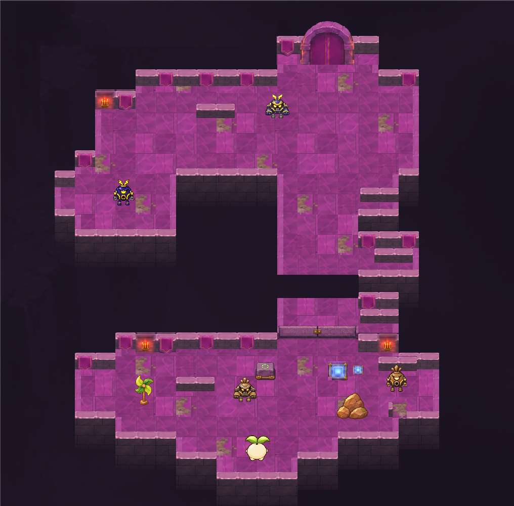
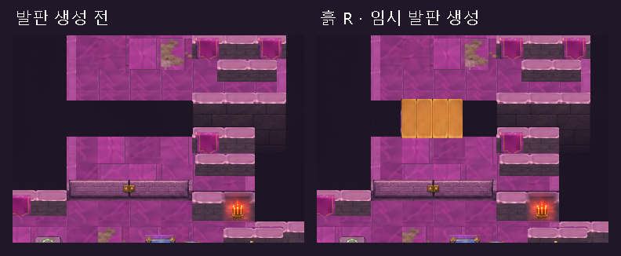

# 8번 방 이동 엄폐실

7번 증기 정원에서 이어지는 일반 방으로 Pico2D에 구현했다. 바람으로 발판에 돌을 올려 사격 구간을 열고, 흙으로 잠깐 엄폐물을 만들어 다음 안전지대까지 이동한다. 적은 흙과 번개 각각 근접형 1명·원거리형 1명으로 배치한다.

## 배치

정면 탑뷰 기준. 시작은 남쪽, 출구는 북쪽이다. 시안은 24×22칸이다. 4~6번 방의 보라색 유적 계열로 구성했다. 6번 방의 바닥, 석벽, 횃불, 깃발과 아치문을 재배치하고, 4번 방의 석문과 밀기 블록을 사용한다. 발판은 5번 방 장치의 외형을, 돌 복귀 장치는 6번 방 연결 스위치의 외형을 빌렸다. 적과 원천은 기존 스프라이트를 사용한다.





```text
                        북 ↑
                     [9번 방 출구]
                 [번개 근접 전투 마당]
                           │
  [번개 사격 발판] →→→ [북쪽 엄폐 홈]
                           │
                ───── [중간 엄폐 홈]
                           │
                  [낭떠러지 · 흙 R]
                           │
                ───── [남쪽 엄폐 홈]
                           │
                    [중앙 석문]
                           │
  [바람개비]      [돌 → 압력 발판]      [돌무더기]
                    [흙 근접·원거리]
                           │
                       [7번 입구]
```

- 남쪽 마당에는 고정 기둥을 두어 원천 쪽으로 이동할 때 흙 원거리 적의 사격선을 끊을 수 있게 한다. 발판 앞에는 돌의 서쪽에 설 공간을 확보한다.
- 석문 너머 통로는 남쪽·중간·북쪽의 엄폐 홈으로 나눈다. 번개 원거리 적은 왼쪽 발판에서 통로를 가로질러 사격한다. 사격 발판은 북쪽 마당에 닿은 뒤 접근할 수 있다.
- 통로 바깥과 남쪽·중간 엄폐 홈 사이에 낭떠러지를 배치한다. 홈 사이의 틈은 복도 전체 너비를 끊는다. 틈을 마주 보는 양쪽 바닥 끝에는 벽이나 난간을 두지 않아, 발판을 놓을 자리가 바로 보인다. 남쪽 마당의 원천, 돌과 발판 주변은 연속된 바닥으로 구성한다.

## 진행

1. 바람개비를 파괴하고 구슬을 `F`로 먹는다. 바람 `Space`로 흙 적 둘을 처치한 뒤 돌 서쪽에서 동쪽을 보고 바람 `R`을 쓰면, 돌이 발판에 닿아 석문을 연다. 발판에 닿은 돌은 고정된다.
2. 돌무더기에서 흙을 얻는다. 남쪽 엄폐 홈에서 사격 발판을 향해 흙 `R`로 벽을 세우고 중간 홈으로 이동한다. 중간 홈에서는 다음 사격 예고를 보고 북쪽으로 건너간다. 흙벽이 사라져도 각 홈에서 대기하거나 이전 홈으로 돌아갈 수 있다. 낭떠러지를 다시 건너려면 흙 발판을 다시 생성한다. 남쪽 흙 원천이 유일한 공급처인 동안에는 중간 홈에도 보충용 흙 원천을 둔다.
3. 북쪽 마당에서 번개 근접 적을 상대하고, 왼쪽 연결로에서 번개 원거리 적을 공략한다. 흙 `Space`가 두 적의 약점을 찌른다. 발판 작동과 적 네 명 처치를 모두 확인하면 북쪽 출구가 열린다. 현재는 8번 방 클리어로 이어진다.

## 재시도와 저장

- 각 원천은 기존의 비약점 3타·약점 1타 규칙을 따른다. 발판이 작동하기 전에 바람을 모두 소비하면 바람개비를 다시 얻을 수 있다. 흙을 모두 소비하면 흙 원천도 재생한다. 중간 홈의 흙 원천도 같은 규칙으로 재생한다. 발판은 5번 방의 임시 지형처럼 4초를 시험값으로 사용한다.
- 돌을 잘못 밀었을 때는 발판 옆 복귀 장치에서 `G`를 눌러 돌을 시작점으로 돌린다. 복귀 장치는 석문 남쪽에서 접근할 수 있다. 플레이어가 시작점에 서 있으면 비운 뒤 작동한다.
- 이어하기는 돌 위치, 발판과 석문, 적 처치, 원천·구슬 상태를 복원한다. 입장 시 7번 방의 체력과 원소를 이어받으며, 타이틀 숫자 `8` 연습 입장에서는 빈 보관함으로도 해결할 수 있게 한다.
- 플레이 테스트에서는 바람·흙을 소진한 뒤 재획득, 잘못 민 돌 복귀, 흙벽 만료 후 후퇴, 낭떠러지와 차단 공격 판정, 발판 작동 직후 이어하기를 확인한다.
