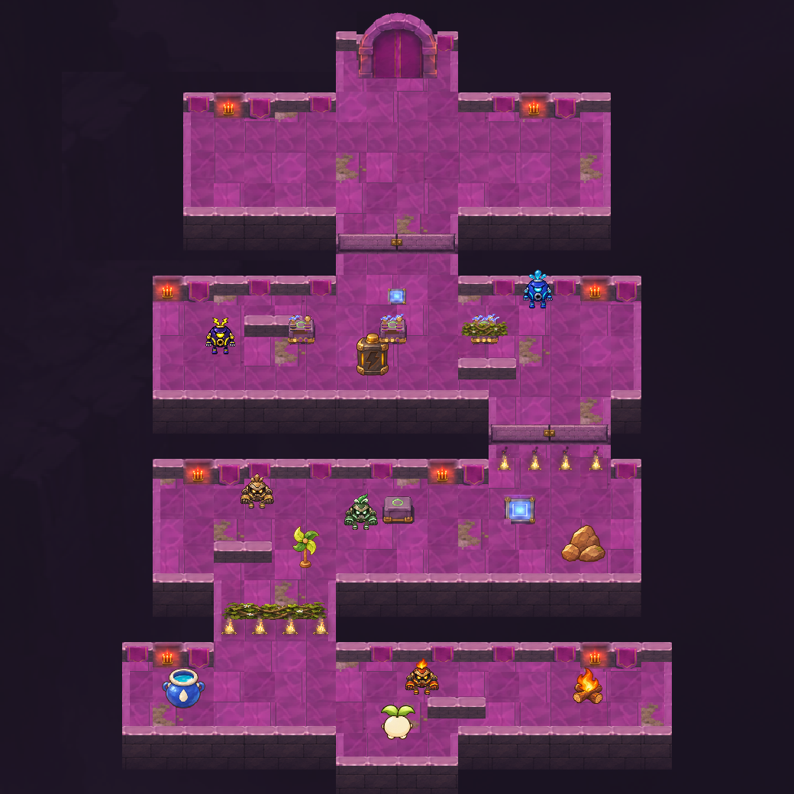

# 9번 방 원소 시험실

8번 방과 10번 보스실 사이의 일반 방이다. 기존 보라색 유적 배치에 두 번째 불길과 전도체 덩굴을 추가해, 앞에서 얻은 원소를 전투와 퍼즐에 번갈아 사용한다.

| 구역 | 원소 조합 |
| --- | --- |
| 남쪽 연결로 | 물 Space로 불 근접형을 상대하고 첫 불길을 끈다. 불 Space로 바로 뒤의 덩굴을 태운다. |
| 돌 발판 마당 | 불 Space로 바람 적을, 바람 Space로 흙 적을 상대한다. 같은 바람을 R로 사용해 돌을 밀고 오른쪽 석문을 연다. |
| 오른쪽 사격 통로 | 석문 바로 앞에 두 번째 불길을 둔다. 석문을 열면 북쪽 사격형의 탄환이 연결로로 들어온다. 흙 R로 사격선 한쪽을 가리고, 물로 바꿔 벽 옆에서 불길을 끈 뒤 통과한다. |
| 전도체 마당 | 오른쪽 전도체는 덩굴에 덮여 있다. 불 Space로 태워야 번개로 충전할 수 있다. 왼쪽 번개 적은 흙으로, 오른쪽 물 적은 번개로 공략한다. |
| 북쪽 출구 | 번개 Space로 전도체 세 개의 단계를 맞추고 G로 전력 문을 연다. 적 다섯 명을 모두 처치하면 보스문이 열린다. |

## 자원과 재시도

- 두 번째 불길과 전도체 덩굴에는 남쪽에서 먹은 물과 불을 다시 쓴다. Space는 원소를 소비하지 않는다. 물 R 회복이나 흙 R 엄폐로 마지막 원소를 썼다면 열린 통로를 통해 원천까지 돌아갈 수 있다.
- 원천은 비약점 3타 또는 약점 1타로 파괴하고 F로 구슬을 먹는다. 필요한 원소를 소진하면 원천이 재생한다. 사격 예고와 고정 엄폐로도 왕복할 수 있게 조정한다.
- 잘못 민 돌은 발판 옆 장치에서 G로 복귀한다. 전도체 오답은 현재 충전 단계만 초기화한다. 진화·소각·개방 상태는 유지하고 이어하기에 저장한다.
- 24×24칸 보라색 석재 배치와 기존 에셋을 유지한다. Pico2D에서 8번 방 출구 또는 타이틀 숫자 9로 입장한다. 사격 간격은 플레이 테스트용이다.

