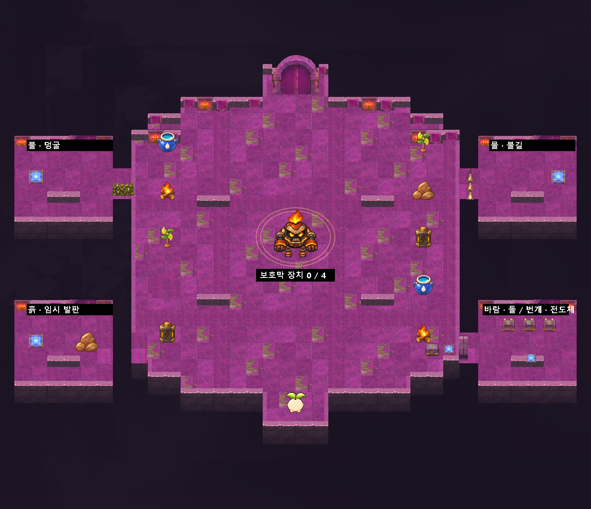

# 10번 방 원소 변환 보스실

9번 원소 시험실 다음의 최종 전투장이다. 맵을 34×28칸으로 넓혀 중앙 전투장과 네 곁방을 두고 6~9번 방의 보라색 석재, 횃불과 아치문을 이어 쓴다. 중앙 보스는 기존 불 근접 적 스프라이트를 확대한 배치용 시안이다.

## 배치와 진행

- 남쪽 입구에서 중앙 전투장에 들어선다. 중앙은 부채꼴 탄환을 피하거나 돌진 경로를 가로질러 빠져나갈 수 있도록 넓게 비운다. 바닥 원형 표식은 보스 시작 위치를 표시한다.
- 양쪽에 낮은 석벽을 두 개씩 배치해 탄환을 끊고 원천을 보충할 자리를 만든다. 엄폐물의 양끝을 돌아 중앙과 외곽 사이를 오갈 수 있게 한다. 낙석은 석벽 뒤에서도 착지 표시를 보고 피한다.
- 물·불·바람·흙·번개 원천을 두 곳씩 배치한다. 흙 원천 하나는 남서 곁방에 둔다. 같은 원소의 좌우 위치를 어긋나게 놓아 한쪽이 공격에 막혀도 반대편에서 얻을 수 있다. 원천을 부수고 구슬을 F로 먹는다. 원천의 재생과 다음 약점 원소 보충은 기존 보스전 규칙을 따른다.
- 보스 처치 후 변신과 공격이 종료되고 북쪽 아치문이 열린다. 그 출구에 도달하면 게임을 클리어한다.

## 곁방과 보호막

전투가 시작되면 보스는 공격과 원소 변신을 시작한다. 보호막이 있는 동안에는 피해가 차단된다. 곁방 안쪽의 차단 장치를 네 개 모두 작동해야 보호막이 풀린다. 순서는 자유이며, 입구를 여는 행동과 안쪽에서 장치를 작동하는 행동은 각각 필요하다.

| 위치 | 입장과 장치 작동 | 얻는 동선 |
| --- | --- | --- |
| 북서 | 불 Space로 덩굴을 태우고 안쪽 차단 장치에서 G를 누른다. | 낮은 석벽 뒤에서 탄환을 피한다. |
| 북동 | 물 Space로 불길을 끄고 안쪽 차단 장치에서 G를 누른다. | 동쪽 회피 공간이 열린다. |
| 남서 | 흙 R로 낭떠러지에 임시 발판을 만들고 건너가 차단 장치에서 G를 누른다. | 안쪽 흙 원천으로 발판을 다시 만들어 돌아올 수 있다. |
| 남동 | 바람 R로 돌을 압력 발판에 밀어 들어간다. 번개 Space로 전도체 세 개의 단계를 맞추고 G로 제출하면 차단 장치도 작동한다. | 북동 곁방까지 외곽 지름길이 열린다. 북동 차단 장치는 별도로 작동한다. |

HUD에 작동한 장치 수를 표시하고, 마지막 장치가 켜지면 보호막을 해제한다. 같은 전투 중에는 보호막과 장치가 초기화되지 않는다. 보호막이 풀린 후에는 현재 원소의 약점으로 보스 체력을 깎는다. 보스의 돌진은 중앙 전투장 안에서 끝나고, 낙석은 곁방에서도 바닥에 예고한다. 다시 시작하면 장치와 보호막도 초기화된다.

## 변신과 대응

| 보스 순서 | 약점 | 공격과 회피 |
| --- | --- | --- |
| 불 | 물 | 부채꼴 탄환을 쏜다. 탄환 사이로 이동한다. |
| 바람 | 불 | 표시한 경로로 직선 돌진한다. 경로 옆으로 빠진다. |
| 흙 | 바람 | 바닥 표시 위에 낙석을 떨어뜨린다. 표시 밖으로 이동한다. |
| 번개 | 흙 | 예고선을 따라 전격탄을 쏜다. 옆으로 피하거나 흙 R로 막는다. |
| 물 | 번개 | 느린 물방울이 퍼진다. 빈 공간을 찾아 이동한다. |

변신 중에도 체력은 이어진다. 현재 속성·약점과 다음 변신 예고를 HUD에 표시하고, 투사체는 적중 시점의 속성으로 판정한다. 체력 450, 원소 유지 8초, 다음 변신 예고 1.5초, 원천 재생 3초는 [기존 보스 설계](STAGES_AND_BOSS.md)의 시험값을 적용한다. Pico2D에서 9번 방 출구 또는 타이틀 숫자 0으로 입장한다. 보스는 원소별 기존 적 스프라이트를 확대해 사용한다.
